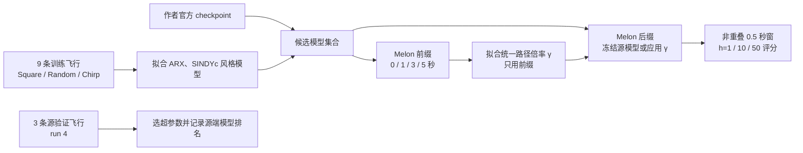

# Nano-Drone 外部系统复核结果 v1

日期：2026-11-03。本文记录第一次按冻结协议完成的 Nano-Drone 外部系统评测。结果已经从源 CSV、官方模型/归一化器和协议哈希重放；这是公开测试集上的非盲外部复核，不是独立盲测。

## 评测问题和信息边界

本轮问的是：源端验证选出的模型能否在未见过的 Melon 飞行上保持优势；以及仅用目标前缀拟合一个很简单的输出校正，能否稳定改善后续 0.5 秒预测。我们比较官方 MLP、LSTM、物理—残差混合模型、作者发布的纯物理实现、ARX 和二次多项式 SINDYc 风格模型。校准不是重新训练模型：每个模型先按原样自由滚动，再对整条预测路径统一执行 `x̂γ(h)=x0+γ·(x̂(h)-x0)`。这个定义对所有模型相同，校正结果不会回灌到窗内递推。

源训练为 9 条轨迹，源验证为另外 3 条；目标是 3 条 Melon 飞行。状态以 0.5 秒为间隔读取，预算分别为 0、1、3、5 秒，对应 0、2、6、10 个校准转移。每个评分窗从当时实测状态重新初始化，模型窗内自由滚动 50 步；每个窗还会收到完整的后续实测电机转速。因此结果表示“已记录未来输入条件下、每 0.5 秒重新初始化的离线预测”，不代表线上事先知道未来控制，也不代表整段飞行的连续自由滚动或闭环控制。

每条目标运行独立拟合 `γ`，再对该运行前缀之后的窗口评分。主要指标为按共同源训练状态尺度归一化的 12 维状态 NRMSE；位置、速度、姿态和角速度误差另行报告。相邻窗口用于计算每条飞行的均值，不当作独立重复。若某个时距有任一窗口产生非有限预测，该运行该时距的主误差记为无穷大，同时报告失败比例。

## 主要观察

源验证按 h=50 的逐运行等权归一化均方误差选出 **author MLP**（0.1094）；ARX 为 0.5789，author hybrid 为 0.7055。到了未见的 Melon 运行，零目标校准预算下 **author hybrid** 的 h=50 NRMSE 最低，为 0.7380（运行间 SD 0.0182）；source-selected MLP 为 0.8585（SD 0.0450），比 hybrid 高约 16.3%。ARX 为 1.1051，LSTM 为 1.1217，零阶保持为 1.2757。也就是说，源端验证的胜者不是这个目标轨迹上的最佳候选。

下表比较同一预算、同一后缀上“源模型冻结”与“用目标前缀拟合 `γ`”的 h=50 NRMSE。每格为三条 Melon 运行等权均值；冻结与校准是配对评测。

| 模型 | 预算 1 秒：冻结 → 校准 | 预算 3 秒：冻结 → 校准 | 预算 5 秒：冻结 → 校准 |
|---|---:|---:|---:|
| 作者 Phys+Residual | 0.7021 → **0.6664** | 0.7000 → **0.6618** | 0.7083 → **0.6700** |
| ARX | 1.0992 → **0.9945** | 1.1010 → **0.9634** | 1.1144 → **0.9648** |
| 作者 MLP | **0.8065** → 0.8193 | 0.8096 → **0.7800** | 0.8123 → **0.7704** |
| 作者 LSTM | **1.0682** → 1.4086 | **1.0568** → 1.1263 | **1.0685** → 1.0910 |

Phys+Residual 的整体状态 NRMSE 在三个预算都比同预算冻结版低约 5%，且三条飞行分别都下降；ARX 也分别下降约 9.5%、12.5% 和 13.4%。但这不是所有状态量都改善：Phys+Residual 的位置 RMSE 在三种预算下都变差，速度 RMSE也变差；姿态测地角误差则改善约 0.9–1.6 度。因此单一倍率改变了误差在状态分量间的分配，综合 NRMSE 变好不能解释为全面改善。

模型依赖也很明显：MLP 在 1 秒预算下略变差，3、5 秒下改善；LSTM 在三个预算和三条运行上都变差，1 秒时平均恶化约 32%。作者发布的 PhysQuad 将角加速度项乘以零；纯 PhysQuad 只作为“原样发布实现”诊断项。官方 Phys+Residual 也调用该物理分支，残差网络可能补偿其中误差，但它的表现不能当成有效物理动力学结构的验证。二次 SINDYc 风格模型在目标窗口出现约 0.8–1.7% 非有限预测，脚本记录了多项式特征乘法溢出；按预先约定，其 h=50 主误差为无穷大。它的源验证误差本来也明显高于 ARX 和作者神经模型。

离线端点插值的 h=50 误差接近零，因为它直接使用当前窗口的真实右端状态。它只是利用未来答案的 oracle 对照，不进入预测模型排名。姿态插值使用 SO(3) 最短路径。

## 这些结果支持什么

**观察到的事实：** 在这个公开无人机数据切分中，源端选出的 MLP 没有成为目标 h=50 最佳模型；简单的单倍率路径校正对 Phys+Residual 和 ARX 的综合 NRMSE 有一致的三运行改善，但改善伴随位置/速度误差上升；对 LSTM 则产生稳定负迁移；二次多项式模型有数值失败。

**有限推断：** 单靠源验证分数不足以在这个“训练轨迹类型到 Melon”的切分中选出目标误差最低的模型；简单目标校正的价值依赖模型和预算。若研究目标是稳健部署，关键问题更像是“什么时候接受校正、什么时候保持原模型”，而不是再增加一个模型结构。

**当前不能声称：** 不能称 `γ` 是新的或通用的迁移算法；不能说它普遍提高预测；不能声称跨物理设备的参数迁移、线上预测、闭环安全或长时间自由滚动已获验证。这里只有一种目标动作类型、三条公开测试飞行；每条运行的前缀和后缀仍来自同一次飞行，窗口也不是独立样本。测试公开且论文分数公开，所以不是盲测。此前已看过的 InTaSet、Motor、OpenMCT 结果也不能再充当新规则的独立确认。

## 复现和数据注意事项

物理参数、作者论文与固定代码的数值差异、数据中观测到的速度/状态范围，以及硬件安全边界缺口，另见[物理约束审计](NANODRONE_PHYSICAL_CONSTRAINTS_AUDIT_20261103.md)和[按训练/验证/测试分组的经验范围表](results/nanodrone_physical_envelope_v1/nanodrone_physical_envelope_by_split.csv)。该范围表只描述已发布的轨迹数据，目标测试行已被读取；它未用于模型选择或调参，不能当作设备安全包线。

最终运行使用 Python 3.12.13、NumPy 2.4.5、pandas 3.0.3、SciPy 1.17.1、scikit-learn 1.7.2、joblib 1.5.3 和 PyTorch 2.12.0。使用 1.7.2 是为了匹配作者 StandardScaler pickle 的保存版本；脚本只读取拟合好的 `mean_` 与 `scale_`。由于环境没有 PyTorch3D，运行使用了与作者状态转换相同的四元数/旋转向量公式兼容层。脚本会核对官方仓库提交、模型源码、scaler、checkpoint 和 CSV LFS 对象；输出 manifest 记录协议、脚本、输入 manifest、权重与结果文件哈希。

作者仓库固定在提交 `2d921b57d166fe2debe08a5d39bd07297c5abc39`。当前 CSV 训练集为 55,599 行，比论文报告少 400 行；原因未知。测试集为 19,497 行。官方测试数据与论文分数均公开。仓库没有单独的代码/数据许可文件，因此本文只引用数据，不重新分发原始 CSV 或模型代码。

结果文件、逐飞行分数和复现入口：

- [运行汇总 CSV](results/nanodrone_external_v1/nanodrone_summary.csv)
- [逐运行、逐预算、逐时距指标](results/nanodrone_external_v1/nanodrone_metrics_by_run.csv)
- [目标校准倍率和前缀误差](results/nanodrone_external_v1/nanodrone_target_calibration.csv)
- [源端超参数/模型选择记录](results/nanodrone_external_v1/nanodrone_source_validation.json)
- [输入、协议、脚本、权重和结果 SHA-256 清单](results/nanodrone_external_v1/nanodrone_run_manifest.json)
- [激励与回归秩诊断](results/nanodrone_external_v1/nanodrone_excitation_diagnostics.json)
- [评分前冻结的评测协议](NANODRONE_EXTERNAL_PROTOCOL_V1_20261103.md)
- [复算脚本](../../scripts/nanodrone_external_control_benchmark_v1.py)

## 下一步研究目标

下一步不应把当前 `γ` 加复杂后再在 Melon 上调优。更可检验的目标是：**在目标观测预算固定时，用目标前缀内部的顺序留出，判断源模型是否值得校准；若验证证据不足或关键物理分量变差，就拒绝更新。** 规则必须在开发域的嵌套整轨迹伪目标中制定，然后冻结到新的目标动作/设备上评估。

1 秒预算只有两个 0.5 秒转移，难以同时可靠地拟合并验证校正；预先考虑在此预算下默认不更新。3、5 秒预算可将前缀分成拟合段和校正验收段，最后的目标后缀保持封存。验收不只看综合 NRMSE，还要同时检查位置、速度、姿态与数值失败率。阈值和模型选择规则要从源伪目标开发，不能根据本次 Melon 后缀反选。

该“接受/拒绝迁移”的问题有已有模型选择与迁移学习研究背景；贡献能否成立取决于冻结后是否在多个方向、多个整段运行和新物理系统上稳定减少负迁移。现阶段应继续把工作定位为**有数据支撑的评测与负迁移边界研究**，不宣称新算法已被证实。
